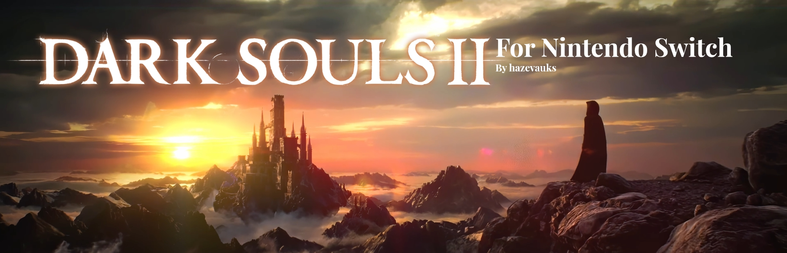

## MajulaRecomp — Dark Souls II on Nintendo Switch




**Dark Souls II (2014)** from Xbox 360 statically recompiled for the handheld console.  
A native port, unlike certain "ports" that are disguised emulators.


## Where the base comes from

The method and almost all of the infrastructure code come from the sibling ports:

| Project | What we use |
|---|---|
| [ChanseyIsTheBest/sa2-nx](https://github.com/ChanseyIsTheBest/sa2-nx) | **The base of this repository** (commit `fdd6f14`, 2026-10-08): `sdk/` (ReXGlue 0.10 with the Horizon layer), `tools/`, `shaders/` (XenosRecomp), and the [porting-guide.md](https://github.com/ChanseyIsTheBest/sa2-nx/blob/main/docs/porting-guide.md) guide, which is the roadmap we follow |
| [StevensND/nfsmw-nx](https://github.com/StevensND/nfsmw-nx) | The Switch layer, the NVK (Mesa) driver with its patch, PGO/LTO, WMV3 video, platform notes |
| [ChanseyIsTheBest/futari-nx](https://github.com/ChanseyIsTheBest/futari-nx) | Another disc game (ISO); a shared notebook of optimisations (`xbox360.md`) |

`sdk/` is kept **identical** to sa2-nx's on purpose, with five exceptions marked `ds2-nx`:

- the audio dump with the sound muted (`sdk/src/audio/sdl/sdl_audio_driver.cpp`);
- the Switch's system keyboard for `XamShowKeyboardUI` (`sdk/src/kernel/xam/xam_ui.cpp`);
- reading the clocks without keeping `clkrst` sessions open (`sdk/src/ui/switch_perf.cpp`);
- the host stack of the game's threads proportional to their guest stack instead of a fixed 16 MB
  (`sdk/src/system/xthread.cpp`);
- the reuse of those stacks (`sdk/src/core/threading_posix.cpp`).

This way the future optimisations of those repositories can be brought in with a plain diff. What is specific to Dark
Souls II lives in `app/` and `docs/`. In `tools/`, `shaders/` and the renderer (`app/src/me`, copied from sa2-nx) the
names `sa2` became `ds2`; the tools that depend on the game's addresses need DS2's own data.

## Status

| Step (sa2-nx's guide) | Status |
|---|---|
| 2. Game files extracted and inspected | **done** (see [docs/ds2-notes.md](docs/ds2-notes.md)) |
| 3. Code translation (`rexglue codegen`) | **done**: 83,143 functions, 0 validation errors; pointer and jump-table scans clean. The delivered code is the "optimised" flavour (registers as C++ locals, direct calls between functions) |
| 4. First PC boot with the emulated GPU | **done**: menus, save creation, the opening movie and the first map loading, with no crash in the game's code |
| 5–6. Native Vulkan renderer and shader library | **done for the areas played so far**: sa2-nx's core ported, a library with the disc's 1,409 shaders; developed on software Vulkan (lavapipe) on the PC, then checked on the console |
| 7. Switch build (devkitA64 + NVK) | **runs on the console**, with nfsmw-nx's NVK driver built here; LTO + PGO builds; played from the start past the Last Giant in long sessions ([docs/switch-testing.md](docs/switch-testing.md)) |
| 8–11. Console measurements and CPU/GPU optimisations | **in progress**: handheld at 540p, stock clocks, 20–22 frames a second at the measuring points of the first areas (from 7.3 at 720p in the first build); 720p selectable live (L3 + R3). Sound, long sessions and area-transition hitches are being worked on; docked mode still to do |

Feature branches: `trofeus` (a trophy screen on the console, unlock notices and our own platinum trophy;
described in `docs/trophies.md` on that branch).

## Layout

```text
app/      the DS2 application: the codegen manifest, analysis corrections (overrides.toml), our own sources
sdk/      ReXGlue SDK (sa2-nx's fork): the Xbox 360 runtime in C++, the code generator, the Horizon layer
shaders/  XenosRecomp and the shader library tools
tools/    extraction, analysis of the generated code, build scripts (tools/win) and measurement
mesa/     notes on the NVK driver
docs/     technical notes on Dark Souls II
```

Outside git (see `.gitignore`): `assets/` (the extracted game), `app/generated/` (generated C++), `out/` (builds),
`_ref/` (clones of the reference repositories) and `_tools/` (portable tools such as LLVM).

## How to reproduce what exists

Prerequisites on Windows: VS 2022 Build Tools (C++ workload; it brings CMake and Ninja), LLVM clang 20 in
`_tools\llvm` (or `DS2_LLVM`), Python 3.12 and Git. Everything runs from PowerShell, never from devkitPro's MSYS2 shell.

```powershell
# 1. Extract the ISO (read only) to assets\game_root and show the XEX header
python tools\extract_iso.py "<path>\Dark Souls II.iso"

# 2. The SDK's third-party sources and the code generator
python tools\fetch_thirdparty.py
powershell -File tools\win\run.ps1 out\host_configure.log "cmake -S sdk -B out/host -G Ninja -DCMAKE_BUILD_TYPE=Release -DCMAKE_C_COMPILER=clang -DCMAKE_CXX_COMPILER=clang++ -DCMAKE_C_FLAGS=-march=x86-64-v2 -DCMAKE_CXX_FLAGS=-march=x86-64-v2"
powershell -File tools\win\run.ps1 out\host_build.log "cmake --build out/host --target rexglue"

# 3. Translate Default.xex to C++ (app\generated, ~350 MB; about 13 min on a 4-thread machine).
#    -Flavor optimised is the delivered code (app\perf_overrides.toml); without it you get the "classic" code.
powershell -File tools\codegen.ps1 -Flavor optimised

# 4. Checks after every codegen (they need out\default_image.bin: run step 3 once with
#    $env:REXGLUE_DUMP_IMAGE = "$PWD\out\default_image.bin")
python tools\switch_check.py
python tools\pointer_audit.py

# 5. PC build (39 min the first time on 4 threads; then only what changed) and a boot test
powershell -File tools/win/run.ps1 out/pc_configure.log "cmake --preset win-pc -S app"
powershell -File tools/win/run.ps1 out/pc_build.log "cmake --build out/pc -- -j4"
powershell -File tools/win/boot_test.ps1 -VideoAt 3 -VideoFrames 50 -VideoEvery 60
```

The boot test runs the game muted and minimised, records one frame a second and makes
`out/pc/captures/video_3s_sheet.png`. On a PC whose GPU has no Direct3D 12 (the development one, an Intel HD 4000),
set `$env:REX_D3D12_ADAPTER = '-2'` first to use Microsoft's software rasteriser (WARP).

### The native renderer on the PC (software Vulkan)

```powershell
# glslangValidator (once) and the shader library, made from the disc's files (~35 min on 4 threads)
powershell -File tools/win/build_glslang.ps1
python tools/extract_shaders.py                        # out/shaders_game: 1,409 containers
bash tools/build_shader_library.sh out/shaders_game    # out/shaders/ds2_shaders.mesp + .idx
copy out/shaders/ds2_shaders.mesp* out/pc/

# Run with the native renderer on lavapipe (Mesa in _tools/mesa; see docs/ds2-notes.md)
$icd = (Resolve-Path _tools/mesa/x64/lvp_icd.x86_64.json).Path
$env:VK_DRIVER_FILES = $icd; $env:VK_ICD_FILENAMES = $icd
$env:REX_DS2_RENDERER_NATIVE = 'true'
powershell -File tools/win/boot_test.ps1 -VideoAt 3 -VideoFrames 60 -VideoEvery 60 -Pad '16-16.6:a,30-30.6:start'
```

The library used in the tests also carries the containers the renderer rebuilds from Direct3D's immediate loads
(`$env:REX_DS2_SHADER_MISSES = 'shader_misses'` writes them to `out/pc/shader_misses/missing`; pass that folder as
the second argument of `build_shader_library.sh`). Tools it needs: DXC in `_tools/dxc` and the clang in
`_tools/llvm`. If the process crashes, `python tools/minidump_summary.py` tells which module it was in.

### The Switch build

```powershell
$env:NVK_SDK = '<the NVK SDK built from nfsmw-nx\'s Mesa>'
powershell -File tools\win\build_switch.ps1 -Jobs 4                          # out\nx\ds2.nro (everyday build)
powershell -File tools\win\build_switch_all.ps1 -Steps "1,2,3"              # everyday, PGO-instrumented, LTO + PGO
python tools\check_switch_build.py                                           # checks an NRO before it ships
powershell -File tools\win\package_switch.ps1 -IncludeGame -LooseGame        # the SD card folder, out\nx\sdcard
```

It follows [sa2-nx's docs/building.md](https://github.com/ChanseyIsTheBest/sa2-nx/blob/main/docs/building.md), with
`sa2` replaced by `ds2`; the details of this game are in [docs/ds2-notes.md](docs/ds2-notes.md).

## License

GPL-3.0, like the projects it comes from (see [LICENSE](LICENSE) and [THIRD_PARTY_NOTICES.md](THIRD_PARTY_NOTICES.md)).
Dark Souls II is the property of FromSoftware / Bandai Namco; this project distributes nothing from the game.
